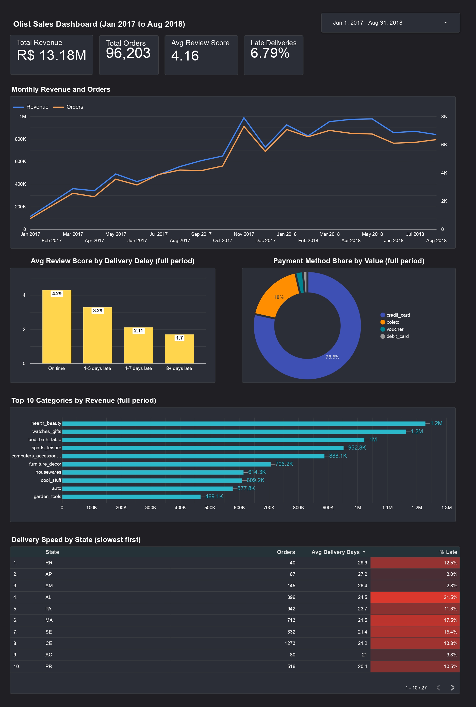
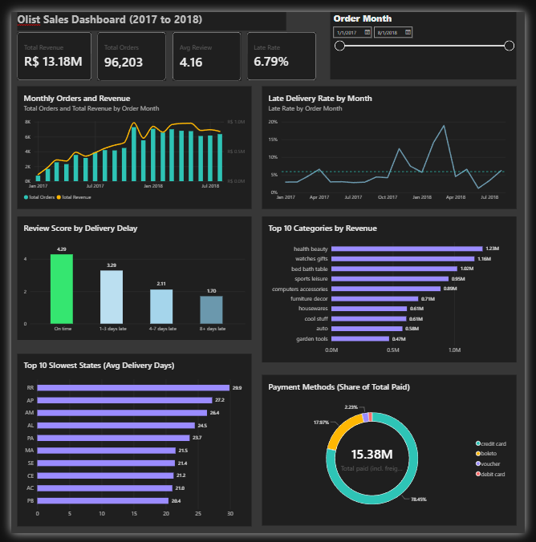

# Olist Sales Dashboard (SQL + Looker Studio + Power BI)

A solo follow-up to my team's [Brazilian E-Commerce EDA](https://github.com/geoLeslie/olist-ecommerce-eda), which was done in Python and Pandas. This time the analysis is written in SQL and presented as an interactive dashboard.

**Dashboard:** [View the interactive dashboard](https://datastudio.google.com/reporting/131ed277-7e3f-4df1-8cc5-232c03ba7cf1)


The KPI cards, monthly trend and state table follow the date filter, and clicking a month in the trend chart filters them to that month. The charts marked "full period" show the whole Jan 2017 to Aug 2018 range.

### Power BI version

The same dashboard rebuilt in Power BI Desktop: [powerbi/olist_sales_dashboard.pbix](powerbi/olist_sales_dashboard.pbix)


- **Power Query** to load the query results, set column types, split the delay labels into a sort order and a label, and clean category names
- **DAX measures** for the KPI cards: `Total Revenue = SUM(orders[revenue])`, `Total Orders = COUNTROWS(orders)`, `Avg Review = AVERAGE(orders[review_score])`, `Late Rate = AVERAGE(orders[is_late])`
- **DAX calculated column** `Order Month` to group orders by month
- A month slicer that filters the KPI cards and both monthly charts, a Top N filter for the 10 slowest states, an average line on the late rate chart, and a custom dark theme ([powerbi/olist_dark_theme.json](powerbi/olist_dark_theme.json))

The donut chart shows total paid by customers (R$15.38M), which includes about R$2.19M of freight, so it is higher than the R$13.18M item revenue in the KPI card.

## Goal

Answer six business questions about Olist, a Brazilian online marketplace, using SQL, then present the results in a one-page dashboard:

1. How do revenue and orders change month by month?
2. How many customers come back to order again?
3. Do late deliveries lead to worse reviews?
4. Which product categories bring in the most revenue?
5. Which states get the slowest deliveries?
6. How do customers pay?

## Data

[Brazilian E-Commerce Public Dataset by Olist](https://www.kaggle.com/datasets/olistbr/brazilian-ecommerce) on Kaggle: about 100k orders from 2016 to 2018 in 9 CSV files.

Definitions used in every query:

- **Revenue** = sum of item prices, without freight
- **Orders** = delivered orders only
- **Period** = Jan 2017 to Aug 2018 (late 2016 has almost no orders, and data after Aug 2018 is incomplete)
- **Late** = delivered on a later day than the estimated delivery date

## Tools

- **DuckDB** as a local SQL database
- **SQL** for the analysis (JOINs, GROUP BY, CTEs, window functions)
- **Python** (duckdb, pandas) to load the CSVs and export query results
- **Looker Studio** (now called Data Studio) for the dashboard, with the query results stored in **Google Sheets**
- **Power BI Desktop** for a second version of the dashboard (Power Query, DAX)
- **DBeaver** to write and test queries

## Project structure

```
data/raw/        Kaggle CSV files (not in git, download them yourself)
sql/             one .sql file per business question
scripts/         load_data.py and run_queries.py
outputs/         query results as CSV (used by the dashboard)
docs/            dashboard guide and screenshots
powerbi/         Power BI report (.pbix) and dark theme
```

## How to run

1. Download the dataset from Kaggle and put the 9 CSV files in `data/raw/`.
2. Set up Python:
   ```bash
   python -m venv .venv
   .venv\Scripts\python.exe -m pip install -r requirements.txt
   ```
3. Load the CSVs into DuckDB (creates `data/olist.duckdb`):
   ```bash
   .venv\Scripts\python.exe scripts\load_data.py
   ```
4. Run all queries and export the results to `outputs/`:
   ```bash
   .venv\Scripts\python.exe scripts\run_queries.py
   ```
5. Build the dashboard by following [docs/dashboard_guide.md](docs/dashboard_guide.md).
6. For the Power BI version, open `powerbi/olist_sales_dashboard.pbix` in Power BI Desktop. If the CSV paths differ on your computer, update them in Transform data, Data source settings.

## Key findings

**1. Revenue grew fast in 2017, then levelled off in 2018.**
Revenue from Jan to Aug 2018 was R$7.22M, 2.4 times the R$2.99M from the same months in 2017. The best month was November 2017 (Black Friday) with R$988k, up 52% from October. During 2018, monthly revenue stayed flat, between R$826k and R$978k.

**2. Almost no customers come back.**
Only 3.0% of customers (2,789 out of 93,104) placed more than one order. Olist depends almost fully on new customers, so retention is a clear opportunity.

**3. Late deliveries destroy review scores.**
6.8% of orders arrived late. On-time orders average 4.29 stars, but orders 1 to 3 days late drop to 3.29, and orders 8 or more days late average just 1.70.
Late deliveries also got worse over time: 5.7% in 2017 vs 7.7% in 2018, mostly from a spike in February (14.1%) and March 2018 (19.0%).

**4. Delivery is much slower outside the Southeast.**
São Paulo (SP) customers wait 8.7 days on average, compared with 29.9 days in Roraima (RR) and 26.4 days in Amazonas (AM). Alagoas (AL) has the highest late rate at 21.5%, almost 5 times SP's 4.5%.

Other results: credit card covers 78.5% of all money paid, with 3.5 installments on average. The top categories are health_beauty (9.3% of revenue) and watches_gifts (8.8%).

## Queries

| File | Question | SQL used |
|---|---|---|
| `01_monthly_revenue.sql` | Monthly revenue, orders and growth | JOIN, CTE, LAG window function |
| `02_repeat_customers.sql` | Repeat customer rate | JOIN, CTE, CASE WHEN, SUM() OVER () |
| `03_late_delivery_reviews.sql` | Late delivery vs review score | CTEs, LEFT JOIN, DATE_DIFF, CASE WHEN |
| `04_top_categories.sql` | Top 10 categories by revenue | 4-table JOIN, COALESCE, RANK() |
| `05_delivery_by_state.sql` | Delivery time and % late by state | JOIN, CTE, DATE_DIFF, RANK() |
| `06_payment_methods.sql` | Payment method share and installments | JOIN, SUM() OVER () |
| `07_dashboard_orders.sql` | One row per order for the dashboard | CTEs, LEFT JOIN |
